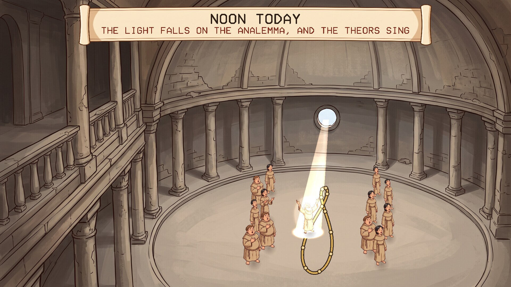
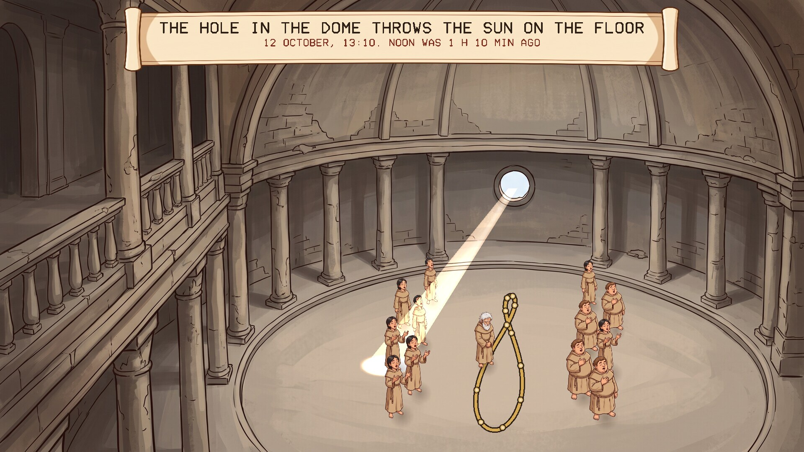
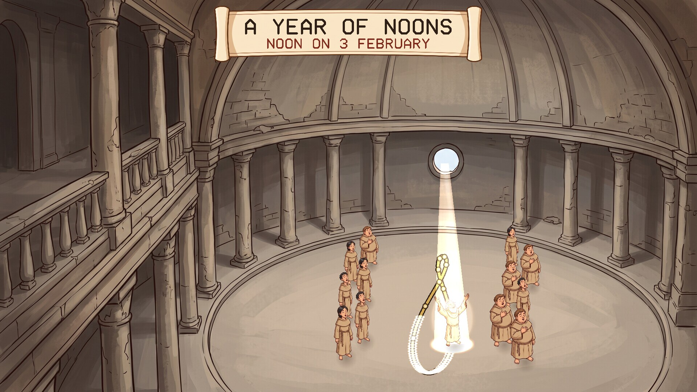

# The Analemma

A screensaver of the analemma in the Temple of Orithena, from Neal Stephenson's
novel *Anathem*, set by the real date and time. Runs on Linux, Windows and macOS. One of the [Anathem screensavers](https://github.com/mottipython/anathem-screensavers).

## The temple

The Temple of Orithena, on the island of Ecba, was a great camera obscura: a small
hole in the roof threw an image of the sun on the floor. The spot fell in a
different place each day, and over a year it traced a long figure of eight, the
analemma, which was inlaid in the floor. At midday the theors gathered and sang,
and their leader stood on the analemma and waited for the light to pass over him.
That aut is what the avout now keep as Provener.

## What the screensaver shows

The light is only ever shown at noon, which is the only time it is on the figure.
Three things in turn, about two minutes in all:

- **Now.** The temple at this moment, by your clock and calendar. The leader
  stands where today's noon falls on the analemma, with a ring marking the place,
  and the scroll says how long it is until noon, or since. If it is noon, the
  light is there. At night the temple is dark.
- **Noon today.** The shaft of light comes down from the hole onto today's place
  on the figure. The leader raises his arms in it and the theors sing.
- **A year of noons.** One noon after another, the spot goes all the way round the
  figure, leaving a trail of light, with the date counting along and the longest
  and shortest days and the two equal days called out. It ends back on today.

| | |
|---|---|
|  |  |
| Now: waiting where today's noon falls | Noon today |
|  |  |
| A year of noons | The whole figure traced |

## The science

The figure is the true one, worked out and not drawn by eye.

- **Where the sun is.** For each day the program finds the sun's place by the
  Astronomical Almanac's short method (mean longitude, mean anomaly, the tilt of
  the axis), which is good to about a hundredth of a degree. From that come the two
  things that make an analemma: how far north or south of the equator the sun is
  that day, and the equation of time, which is how far the real sun runs ahead of
  a steady clock or behind it.
- **Why a figure of eight.** If the sun kept perfect time, the noon spot would only
  move up and down one straight line through the year. Because it runs up to 16
  minutes fast in early November and 14 minutes slow in February, the spot is
  carried to one side and then the other, and the line opens into two loops.
- **Where the spot falls.** A ray from the sun through the hole lands on the floor
  beyond the hole, as far away as the hole is high divided by the tangent of the
  sun's height. High summer sun puts it close under the hole; low winter sun
  throws it far across the floor. Low sun also draws the round image out into an
  oval, and it is drawn that way.

Checked against the almanac: the ends of the figure are the solstices (21 June and
21 December), the two loops cross on 12 April and 30 August, the spot is on the
centre line on 15 April, 12 June, 1 September and 24 December, it is furthest
east on 8 November and furthest west on 6 February, and the figure is seven times
as long as it is wide, with the summer loop much the smaller. Those are the right
dates and proportions for our sun at this latitude.

Two things it cannot know. Noon here is twelve by your clock, with summer time
taken off; where you are within your time zone is not allowed for, so real noon
where you live may be up to half an hour or so either side. And the brass studs
mark the first of each month in a year of 365 days.

### What is from the book and what is mine

From the book: the temple as a camera obscura, the spot on the floor, the analemma
traced over the year, the theors gathering to sing at midday and their leader
standing on the figure.

Mine: Ecba's latitude, which the book does not give (I used 35 degrees north);
putting the hole in the side of the dome that faces the sun, so that the whole
figure falls on the floor all year; and using our own sun and year, since Arbre's
are not described. Showing the light only at noon is a choice too: for the rest
of the day the spot would be wandering across the floor away from the figure.

## Install

Packages are on the [releases page](../../releases).

### Windows

Run `Analemma-Setup-1.0.1.exe`. It asks for administrator rights, because Windows
only lists screensavers that are in its own system folder. After that "The Analemma" is in Screen Saver Settings with the others, already selected. Uninstall from
Apps.

### macOS

There are two downloads on the releases page, for Apple Silicon and Intel, macOS 11
or later.

**The screen saver** is the file ending `-mac-screensaver.zip`. Unzip it and
double-click the `.saver` file; macOS offers to install it. Then choose it in System
Settings, Screen Saver (scroll to the end of the list, under Other).

**The app** is the file ending `-mac.zip`: the same thing as an ordinary program
that runs full screen until you press a key.

Neither is signed with an Apple developer certificate, so macOS will refuse them at
first. After the refusal, open System Settings, Privacy & Security, scroll down,
and click Open Anyway. If the screen saver still will not load, clear the
quarantine mark in Terminal:

    xattr -dr com.apple.quarantine ~/Library/"Screen Savers"

Both are built on a Mac build machine, where the screen saver is loaded and made to
draw as a test. They have not yet been tried by a person on a real Mac, and screen
savers on recent macOS are known to be temperamental; reports are welcome.

### Linux

**Fedora, Nobara** (built on Fedora 44):

    sudo dnf install ./analemma-1.0.1-1.fc44.x86_64.rpm

**Debian, Ubuntu, Mint** (Ubuntu 24.04 / Debian 13 or later):

    sudo apt install ./analemma_1.0.1_amd64.deb

From your next login it starts by itself after five minutes idle, and any key or
mouse movement ends it. To start the watcher without logging out, or to change the
delay:

    analemma-screensaver enable 10    # after 10 minutes idle
    analemma-screensaver disable
    analemma-screensaver status
    analemma-screensaver now          # run it right away

Wayland desktops have no screensaver service to plug into, so the package starts a
small idle watcher (`swayidle`) at login. It works on compositors that provide the
ext-idle-notify protocol: KDE Plasma, Sway, Hyprland, niri, COSMIC, labwc and
others. GNOME does not provide it, and on X11 you would add `analemma` to
xscreensaver or your desktop's own idle settings. It does not lock the screen. If
one of the other *Anathem* screensavers
([Teglon](https://github.com/mottipython/teglon),
[the Lazy Peregrin](https://github.com/mottipython/lazy-peregrin),
[Cutting the Cake](https://github.com/mottipython/cutting-the-cake),
[the Clock of Saunt Edhar](https://github.com/mottipython/edhar-clock),
[the Weed War](https://github.com/mottipython/weed-war),
[the Daban Urnud](https://github.com/mottipython/daban-urnud),
[the Adrakhonic Theorem](https://github.com/mottipython/adrakhonic)) is already on
screen it stays out of the way.

## Running it yourself

    analemma              full screen on every display; any key or mouse movement quits
    analemma --window     in a window; Esc or Q quits
    analemma --speed 2    faster
    analemma --date 06-21 show this day instead of today
    analemma --at 12:00   show this time instead of now
    analemma --snapshot out.bmp --time 60 --size 1920x1080

## Building

Needs a C compiler, make and SDL2 (2.0.18 or newer). Build from the top of the
source tree, because the pictures in `assets/art` are built into the program.

    make
    make check
    sudo make install

Packages are written to `dist/`. `tools/Containerfile` describes a container with
everything they need:

    podman build -t anathem-build -f tools/Containerfile tools
    podman run --rm --security-opt label=disable -v "$PWD":/src -w /src anathem-build make dist

## Credits and licence

MIT. *Anathem* and Orithena are Neal Stephenson's; this is an unofficial fan
project.

The pictures (the temple, the theors, the light and the scroll) were drawn with
Google Gemini and prepared by `tools/make_sprites.py`. Images are decoded with
[stb_image](https://github.com/nothings/stb) (public domain).
