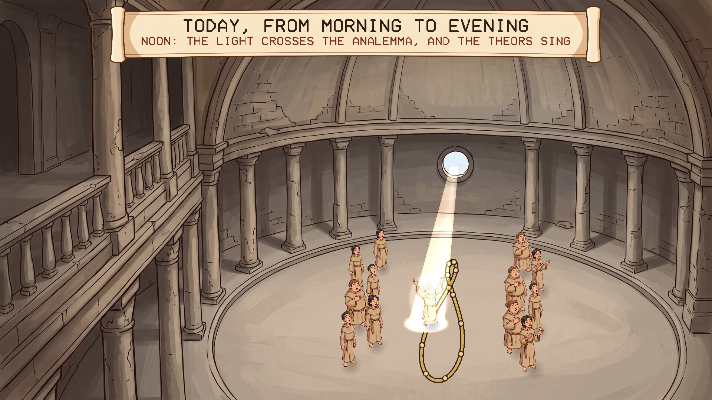
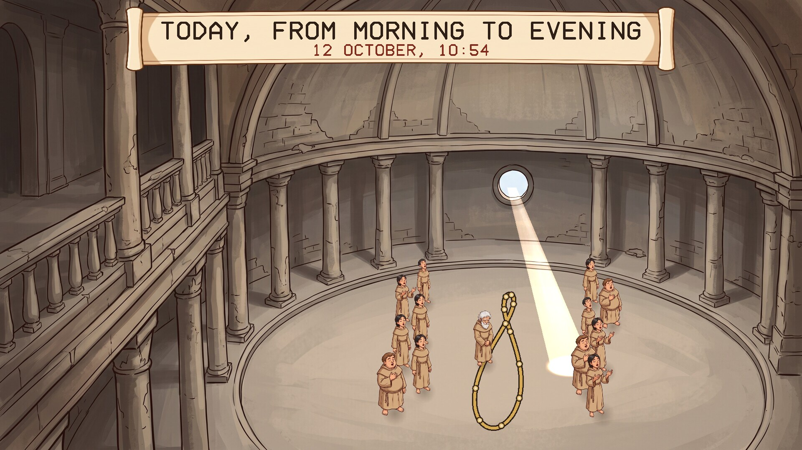
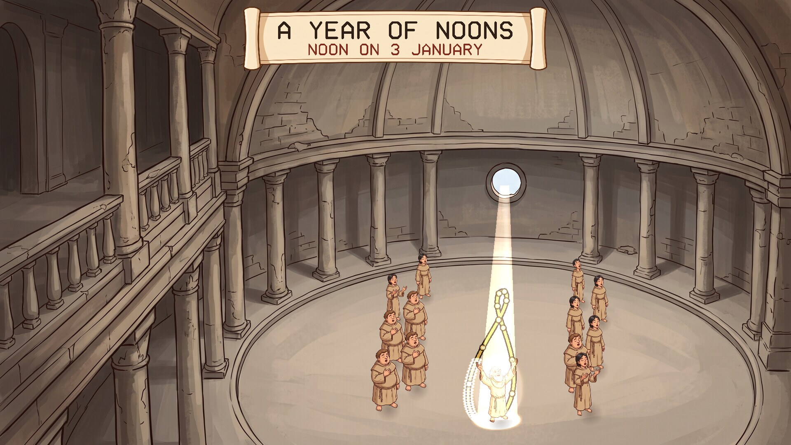
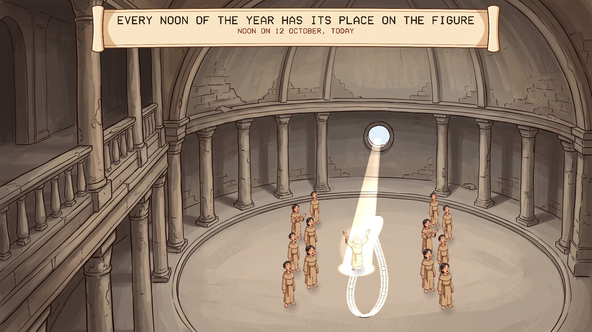

# The Analemma

A screensaver of the analemma in the Temple of Orithena, from Neal Stephenson's
novel *Anathem*, set by the real date and time. Runs on Linux and Windows.

## The temple

The Temple of Orithena, on the island of Ecba, was a great camera obscura: a small
hole in the roof threw an image of the sun on the floor. The spot fell in a
different place each day, and over a year it traced a long figure of eight, the
analemma, which was inlaid in the floor. At midday the theors gathered and sang,
and their leader stood on the analemma and waited for the light to pass over him.
That aut is what the avout now keep as Provener.

## What the screensaver shows

Three things in turn, about two minutes in all:

- **Now.** The temple at this moment, by your clock and calendar. If the sun is
  high enough the shaft of light comes down from the hole to the floor, and the
  scroll says how long it is until noon, or since. At night the temple is dark.
- **Today, speeded up.** The spot sweeps across the floor from morning to evening,
  slowing as it comes to the analemma and crossing it at noon, where the leader is
  waiting. He raises his arms as the light reaches him.
- **A year of noons.** One noon after another, the spot goes all the way round the
  figure, leaving a trail of light, with the date counting along and the longest
  and shortest days and the two equal days called out. It ends back on today.

| | |
|---|---|
|  |  |
| Now | Today: the light coming across the floor |
|  |  |
| A year of noons | The whole figure traced |

The figure is the true one. The spot is worked out from where the sun really is:
its height from the time of year, and its running ahead of the clock or behind it
(the equation of time), which is what makes the curve a figure of eight and not a
straight line. The brass studs on it mark the first of each month. Noon here means
twelve by your clock; summer time and where you are in your time zone are not
allowed for.

### What is from the book and what is mine

From the book: the temple as a camera obscura, the spot on the floor, the analemma
traced over the year, the theors gathering to sing at midday and their leader
standing on the figure.

Mine: Ecba's latitude, which the book does not give (I used 35 degrees north);
putting the hole in the side of the dome that faces the sun, so that the whole
figure falls on the floor all year; and using our own sun and year, since Arbre's
are not described. The spot is only shown when it is on the floor: early and late
in the day the sun is too low to reach it.

## Install

Packages are on the [releases page](../../releases).

### Windows

Run `Analemma-Setup-1.0.0.exe`. It asks for administrator rights, because Windows
only lists screensavers that are in its own system folder. After that "The Analemma" is in Screen Saver Settings with the others, already selected. Uninstall from
Apps.

### Linux

**Fedora, Nobara** (built on Fedora 44):

    sudo dnf install ./analemma-1.0.0-1.fc44.x86_64.rpm

**Debian, Ubuntu, Mint** (Ubuntu 24.04 / Debian 13 or later):

    sudo apt install ./analemma_1.0.0_amd64.deb

From your next login it starts by itself after five minutes idle, and any key or
mouse movement ends it. To start the watcher without logging out, or to change the
delay:

    analemma-screensaver enable 10    # after 10 minutes idle
    analemma-screensaver disable
    analemma-screensaver status
    analemma-screensaver now          # run it right away

Wayland desktops have no screensaver service to plug into, so the package starts a
small idle watcher (`swayidle`) at login. It works on compositors that provide the
ext-idle-notify protocol: KDE Plasma, Sway, Hyprland, niri, COSMIC, labwc and
others. GNOME does not provide it, and on X11 you would add `analemma` to
xscreensaver or your desktop's own idle settings. It does not lock the screen. If
one of the other *Anathem* screensavers
([Teglon](https://github.com/mottipython/teglon),
[the Lazy Peregrin](https://github.com/mottipython/lazy-peregrin),
[Cutting the Cake](https://github.com/mottipython/cutting-the-cake),
[the Clock of Saunt Edhar](https://github.com/mottipython/edhar-clock),
[the Weed War](https://github.com/mottipython/weed-war),
[the Daban Urnud](https://github.com/mottipython/daban-urnud),
[the Adrakhonic Theorem](https://github.com/mottipython/adrakhonic)) is already on
screen it stays out of the way.

## Running it yourself

    analemma              full screen on every display; any key or mouse movement quits
    analemma --window     in a window; Esc or Q quits
    analemma --speed 2    faster
    analemma --date 06-21 show this day instead of today
    analemma --at 12:00   show this time instead of now
    analemma --snapshot out.bmp --time 60 --size 1920x1080

## Building

Needs a C compiler, make and SDL2 (2.0.18 or newer). Build from the top of the
source tree, because the pictures in `assets/art` are built into the program.

    make
    make check
    sudo make install

Packages are written to `dist/`. `tools/Containerfile` describes a container with
everything they need:

    podman build -t anathem-build -f tools/Containerfile tools
    podman run --rm --security-opt label=disable -v "$PWD":/src -w /src anathem-build make dist

## Credits and licence

MIT. *Anathem* and Orithena are Neal Stephenson's; this is an unofficial fan
project.

The pictures (the temple, the theors, the light and the scroll) were drawn with
Google Gemini and prepared by `tools/make_sprites.py`. Images are decoded with
[stb_image](https://github.com/nothings/stb) (public domain).
